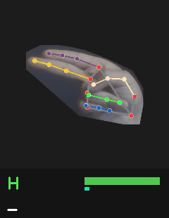
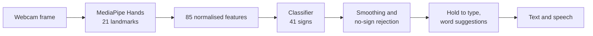
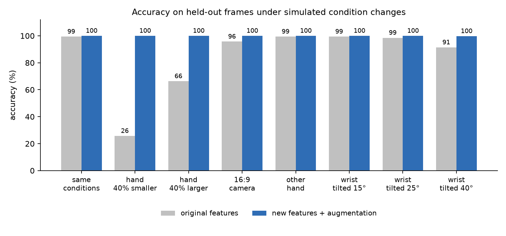

# ASL fingerspelling recognition

[](https://github.com/Sayyam-wad/sign_language_detector/actions/workflows/ci.yml)

Recognises the American Sign Language alphabet and 15 common gesture phrases from a webcam, turns them into text and reads the text out loud.

**Try it in the browser:** https://sayyam-wad.github.io/sign_language_detector/ (needs a webcam; nothing is uploaded, everything runs in the page)

<p align="center"></p>

## How it works

1. MediaPipe Hands finds 21 landmarks on the hand in each frame.
2. The landmarks are turned into 85 features: wrist-relative 3D coordinates, the bend angle of every finger joint and the distances between fingertips. They are normalised so that hand size, distance from the camera, camera aspect ratio and left/right hand don't matter, while the direction the hand points (which separates H from U, K from P) is kept.
3. A classifier (SVM in the Python app, a small neural network in the browser) predicts one of 41 signs.
4. Predictions are smoothed over frames. Poses that don't look like any trained sign are ignored, and holding a sign for about a second types it.
5. While you spell, the app suggests words (press 1, 2 or 3 to take one) and can correct a misread letter, for example HELLP to HELLO.



## Results

Trained and tested on 4,100 images of 41 signs (100 each) recorded by one person. Consecutive webcam frames are nearly identical, so the test set is made of whole blocks of frames that were never seen in training.

| | |
|---|---|
| SVM accuracy on held-out frames | 100% |
| Browser model accuracy on held-out frames | 98.8% |
| Time per frame | about 10 ms on one CPU core (9.6 ms of it is MediaPipe) |

Because the data comes from one person in one room, those numbers mostly show that the model is consistent. To check how it copes with a different setup, `asl.benchmark` changes the held-out hands (smaller, larger, tilted, other hand) and compares the current features with the original ones:



| Change | Original features | Current features |
|---|---|---|
| Hand 40% smaller (standing back) | 25.7% | 100% |
| Hand 40% larger | 66.3% | 100% |
| 16:9 camera instead of 4:3 | 95.7% | 100% |
| Other hand | 99.4% | 100% |
| Wrist tilted 40° | 91.4% | 99.8% |

The "no sign" check ignores 79% of poses it was never trained on while accepting 96.6% of real signs frame by frame. More detail, including how this was measured, is in the [model card](docs/MODEL_CARD.md) and the [evaluation report](artifacts/report/report.md).

## Running it

Python 3.9 to 3.12:

```bash
git clone https://github.com/Sayyam-wad/sign_language_detector.git
cd sign_language_detector
python -m venv venv
venv\Scripts\activate            # on macOS/Linux: source venv/bin/activate
pip install -e ".[speech]"
asl-doctor                       # checks packages, MediaPipe and cameras
asl-app                          # starts recognition with the included model
```

Keys in the app:

| Key | Action |
|---|---|
| L / P | letters or phrases |
| hold a sign | types it after about a second |
| Enter | type the current sign now |
| 1, 2, 3 | pick a suggested word |
| Space, Backspace, C | space, delete, clear |
| S | speak the text |
| T | text to sign: type something and see how to sign it |
| Q | quit |

`asl-app --source video.mp4 --headless` prints what gets typed from a video file instead of opening a window.

## Training on your own data

```bash
asl-collect A B C HELLO --count 60   # record signs; run it again on other days or with other people
asl-dataset                          # images -> landmarks -> features
asl-train                            # compares 5 models, writes artifacts/ and web/model.json
asl-benchmark                        # robustness tests
asl-atlas                            # updates the reference drawings of each sign
```

Images go in `data/<class id>/` and the class ids are listed in `asl/labels.py`. Each run of `asl-collect` is saved as a separate session, and evaluation never mixes frames from the same session between training and testing, so recording more sessions gives a more realistic accuracy number. Settings such as `ASL_CAMERA_INDEX=1` or `ASL_HOLD_SECONDS=1.0` can be set as environment variables.

## Project layout

```
asl/
  features.py      landmark features
  augment.py       rotated copies for training
  dataset.py       images to features
  train.py         model comparison, evaluation, export
  benchmark.py     robustness tests
  novelty.py       "no sign" detection
  recognizer.py    smoothing, letter/phrase modes, typing logic
  words.py         word suggestions
  atlas.py         reference drawing for each sign
  app.py           webcam app
  collect.py       recording training images
web/               browser version (JavaScript port, checked against Python in CI)
tests/             29 tests, no webcam needed
```

## Limitations

- Trained on one person, so it will be less accurate for others until more people are recorded.
- J and Z involve movement; only their end position is recognised.
- One hand at a time, so two-handed signs aren't supported.
- Five phrases share a hand shape with a letter (NO and C, for example). The letter/phrase switch decides which one is meant.
