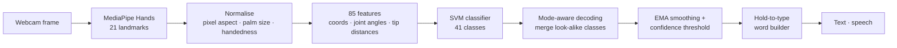

# Real-time ASL Recognition — Sign Language to Text & Speech

[](https://github.com/Sayyam-wad/sign_language_detector/actions/workflows/ci.yml)


Recognises the 26 letters of the American Sign Language alphabet and 15 common gesture phrases from a webcam, turns them into text, and reads the text aloud. Recognition takes about 10 ms per frame on a single CPU core.

<p align="center"></p>
<p align="center"><sub>Pipeline demo: dataset frames played back as a clip; only the hand is shown.</sub></p>

## Highlights

- **Robust hand-shape features.** 85 features from MediaPipe's 21 hand landmarks — wrist-relative 3-D coordinates, 15 finger-joint angles and fingertip distances — normalised for hand size, camera aspect ratio and left/right hand. On held-out data, accuracy when the hand is 40% smaller (standing further back) goes from **26% → 100%** compared with the original distance features.
- **Rotation augmentation in landmark space.** Rotated copies of every sample make the model tolerant to wrist tilt (40° tilt: **39% → 99.8%**) without collecting more images, while keeping the orientation cue that separates look-alike letters such as H/U and K/P.
- **Leakage-aware evaluation.** Consecutive webcam frames are near-duplicates, so splits are made by recording session or frame block, the model is chosen by grouped cross-validation, and the test set is touched once. A separate robustness benchmark measures what actually breaks in real use.
- **Mode-aware decoding.** Some phrases share a hand shape with a letter (NO ↔ C, PEACE ↔ V, …). In letter mode their probabilities are summed into the letter, in phrase mode into the phrase, instead of the model guessing between two near-identical classes.
- **Usable app.** Probability smoothing, a confidence threshold, hold-to-type with a progress bar, automatic spaces, repeated letters (H-E-L-L-O), non-blocking text-to-speech, and a text-to-sign viewer. A headless mode turns a video file into a transcript.
- **Engineering.** Installable package with CLI entry points, pinned dependencies, environment doctor, 19 unit tests (no camera needed), GitHub Actions CI.

## Results

Dataset: 4,100 images, 41 classes (100 per class), one signer. MediaPipe found a hand in 4,091 of them (99.8%).


| Scenario (test frames transformed) | Original features | New features | New + augmentation |
|---|---|---|---|
| Same conditions | 99.4% | 100.0% | 100.0% |
| Hand 40% smaller (further from camera) | 25.7% | 100.0% | 100.0% |
| Hand 40% larger (closer) | 66.3% | 100.0% | 100.0% |
| 16:9 instead of 4:3 camera | 95.7% | 100.0% | 100.0% |
| Other hand (mirror image) | 99.4% | 100.0% | 100.0% |
| Wrist tilted 15° | 99.4% | 89.2% | 100.0% |
| Wrist tilted 40° | 91.4% | 38.7% | 99.8% |

Same SVM and the same grouped train/test split in every column; only the features differ. Full tables: [`artifacts/report/robustness.md`](artifacts/report/robustness.md) and [`artifacts/report/report.md`](artifacts/report/report.md).

**Reading these numbers honestly.** Every class in this dataset was recorded in a single session by one person, so held-out frames come from the same recording as the training frames. On that test the task is easy: all five model types reach 99.5–99.9% macro-F1 in grouped cross-validation, and the chosen SVM gets 100% on the held-out block. That measures consistency within a recording, not how well the model works for a new person or room. The robustness benchmark covers the geometric part of that gap; covering people and lighting needs more recordings — `python -m asl.collect` saves each run as a separate session and evaluation automatically keeps sessions apart.

Latency, measured on one CPU core: MediaPipe hand detection ≈ 9.6 ms, features + SVM + smoothing ≈ 0.9 ms per frame (camera capture and drawing not included).

## Quick start

```bash
git clone https://github.com/Sayyam-wad/sign_language_detector.git
cd sign_language_detector
python -m venv venv && source venv/bin/activate      # Windows: venv\Scripts\activate
pip install -r requirements.txt                       # Python 3.9-3.12
python -m asl.doctor                                  # checks packages, MediaPipe API, cameras
python -m asl.app                                     # uses the trained model in artifacts/
```

### Train on your own data

```bash
python -m asl.collect A B C HELLO --count 60   # record signs (names or class ids); repeat on other days
python -m asl.collect --list                   # images per class
python -m asl.dataset                          # images -> landmarks -> features (artifacts/features.npz)
python -m asl.train                            # grouped CV model selection, held-out test, report
python -m asl.benchmark                        # robustness benchmark
```

Images live in `data/<class_id>/` (the class ids are listed in [`asl/labels.py`](asl/labels.py)). Settings can be overridden with environment variables, e.g. `ASL_CAMERA_INDEX=1`, `ASL_DATA_DIR=D:/my_data`, `ASL_HOLD_SECONDS=1.0`.

### App controls

| Key | Action | Key | Action |
|---|---|---|---|
| `L` / `P` | letter / phrase mode | `A` | toggle hold-to-add |
| hold a sign | adds it after ~1.2 s | `ENTER` | add the current sign now |
| `SPACE` | space (also added after 2 s with no hand) | `BACKSPACE` | delete |
| `S` | speak the text | `C` | clear |
| `T` | text-to-sign viewer | `Q` / `ESC` | quit |

`python -m asl.app --source clip.mp4 --headless` prints what gets typed from a video file.

## How it works



| Module | Role |
|---|---|
| `asl/landmarks.py` | MediaPipe wrapper (static mode for photos, tracking for video) |
| `asl/features.py` | feature extraction and normalisation |
| `asl/augment.py` | rotation augmentation in landmark space |
| `asl/dataset.py` | images → features, with session/block groups |
| `asl/train.py` | model comparison, grouped evaluation, report |
| `asl/benchmark.py` | robustness benchmark |
| `asl/recognizer.py` | smoothing, mode-aware decoding, word builder (camera-independent, unit-tested) |
| `asl/app.py`, `collect.py`, `doctor.py`, `tts.py` | app, data collection, environment check, speech |

## What changed in v2

The original scripts had several bugs that this version fixes:

- **Fresh installs crashed.** MediaPipe 0.10.30+ removed the `mp.solutions.hands` API and the requirements were unpinned; the root `requirements.txt` contained `pip install` commands.
- **No scale normalisation.** The README said the features were normalised by hand size; they weren't. Moving away from the camera changed every feature (26% accuracy at 0.6× size).
- **Photos processed in video-tracking mode.** `static_image_mode=False` on unrelated dataset images let tracking state leak between them; detection confidence was 0.1.
- **Signing "A" in letter mode printed "S"**, and repeated letters could never be added, so words like HELLO were impossible to spell.
- **Model chosen on the test set**, the configured confidence threshold and hold timer were never used, speech froze the video, and paths were hard-coded to `E:/`.

## Limitations

- J and Z are motion signs; a single-frame classifier only sees their final pose.
- Trained on one signer. Expect lower accuracy for other people until more sessions are recorded.
- Two-handed signs are not supported (one hand is tracked).
